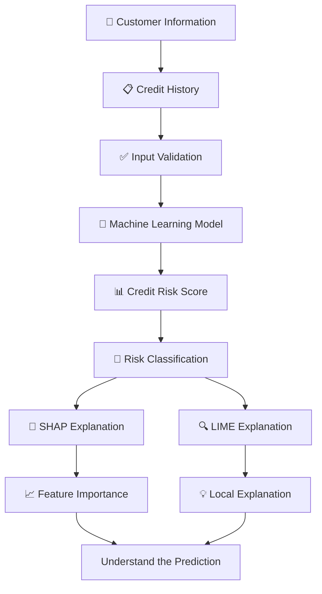

# 💳 CreditLens
### Explainable Credit Default Prediction using SHAP, LIME & Tree-Based Models

<p align="center">
  <b>🔍 Predict. Explain. Understand.</b>
  <br/>
  Making Machine Learning credit-risk predictions transparent, interpretable and understandable.
</p>

<p align="center">
  
  
  
  
  
</p>

---

## 🌟 About CreditLens

**CreditLens** is an Explainable Artificial Intelligence (XAI) powered credit default prediction application designed to estimate customer credit risk and explain the reasoning behind its predictions.

Traditional Machine Learning models can generate predictions without clearly explaining why a particular result was produced.

CreditLens addresses this challenge by combining Tree-Based Machine Learning algorithms with Explainable AI techniques such as **SHAP and LIME**.

The application analyses customer profiles and repayment history, generates a model-based risk score, and provides meaningful explanations of the factors influencing the prediction.

> 💡 Our goal is not just to predict credit default risk, but to make every prediction understandable.

---

## 🎯 Problem Statement

Traditional credit-risk prediction systems often behave like black boxes.

They may provide predictions without clearly explaining:

- Why a customer is classified as high or low risk.
- Which repayment behaviours influence the prediction.
- Which customer features contribute most to the result.
- How different factors affect the model's estimated risk.

### 💡 Our Solution

CreditLens combines Machine Learning predictions with transparent, feature-level explanations to make credit-risk analysis easier to interpret.

---

## 🚀 Key Features

| Feature | Description |
|---|---|
| 💳 Credit Risk Prediction | Estimates customer credit default risk using Machine Learning. |
| 🌳 Random Forest | Uses a tree-based model for prediction. |
| 📊 Model Performance | Displays evaluation metrics and visualizations. |
| 🧠 SHAP Explainability | Explains individual feature contributions. |
| 🔍 LIME Explanations | Provides local explanations for individual predictions. |
| 📈 Feature Importance | Identifies influential features across evaluated customers. |
| 👥 Customer Analytics | Provides customer-related analytical insights. |
| 📄 Document Check | Supports document-related verification. |
| 💰 Financial Health Calculator | Provides financial health calculations. |
| 📚 Financial Awareness | Provides financial awareness information. |

---

## 🧠 Explainable AI – The Heart of CreditLens

### 1. SHAP – SHapley Additive exPlanations

SHAP explains how individual features contribute to a Machine Learning prediction.

**What it provides:**
- Individual customer prediction explanations.
- Positive and negative feature contributions.
- Overall feature importance.
- Visual representation of feature influence.

### 2. LIME – Local Interpretable Model-Agnostic Explanations

LIME explains individual predictions using a simpler local approximation of the original Machine Learning model.

**What it provides:**
- Local prediction explanations.
- Identification of influential input features.
- Positive and negative feature weights.
- Easier interpretation of complex model behaviour.

### 3. Tree-Based Machine Learning

Random Forest analyses customer information and repayment patterns to estimate credit default risk.

---

## ⚙️ How CreditLens Works



---

## 📸 Application Screenshots

Screenshots of the actual application will be added here.

### 🏠 Main Dashboard


### 💳 Credit Risk Prediction


### 🧠 SHAP Explanation


### 🔍 LIME Explanation


### 📊 Model Performance


---

## 🛠️ Technology Stack

| Category | Technologies |
|---|---|
| Programming Language | Python |
| Frontend / Interface | Streamlit |
| Data Processing | Pandas, NumPy |
| Machine Learning | Scikit-learn |
| Prediction Algorithm | Random Forest |
| Explainable AI | SHAP, LIME |
| Visualization | Plotly, Matplotlib |
| Development Environment | VS Code, Linux |
| Version Control | Git & GitHub |

---

## 📊 Why Explainable AI?

| Traditional ML | CreditLens |
|---|---|
| Gives predictions | Gives predictions with explanations |
| Limited transparency | Feature-level transparency |
| Difficult to interpret | Easier to understand |
| Focuses on prediction | Focuses on prediction and interpretation |

---

## 💻 Installation & Setup

### Prerequisites

- Python 3.10+
- Visual Studio Code
- Git

### 1. Clone the repository

```bash
git clone YOUR_GITHUB_REPOSITORY_URL
```

### 2. Navigate to the project directory

```bash
cd YOUR_REPOSITORY_FOLDER
```

### 3. Create a virtual environment

```bash
python -m venv venv
```

### 4. Activate the environment

**Windows:**

```bash
venv\Scripts\activate
```

**Linux / Ubuntu:**

```bash
source venv/bin/activate
```

### 5. Install dependencies

```bash
pip install -r requirements.txt
```

### 6. Run the application

```bash
streamlit run app.py
```

🎉 CreditLens will open in your browser!

---

## 🔮 Future Enhancements

- 🔐 Improved customer information validation.
- 📄 Enhanced document-based verification.
- 🤖 Evaluation of additional Machine Learning algorithms.
- 📊 Improved prediction and explanation visualizations.
- ☁️ Secure cloud deployment.
- 🔗 Integration with verified financial data sources.

---

## 🎓 Project Purpose

CreditLens is an academic Machine Learning project demonstrating how Explainable AI techniques can improve the interpretability and transparency of credit-risk prediction systems.

**Note:** CreditLens is an educational project. Its predictions are model estimates and should not be treated as actual financial or lending decisions.

---

## 👨‍💻 Developer

**CreditLens – Explainable AI Project**

Built using Python, Machine Learning, Streamlit, SHAP and LIME.

---

<p align="center">
  <b>💳 CREDITLENS</b>
  <br/>
  <i>See the Prediction. Understand the Reason.</i>
  <br/><br/>
  Bringing Transparency to Credit Risk Prediction through Explainable AI.
  <br/><br/>
  ⭐ If you find this project interesting, consider giving the repository a star!
</p>
